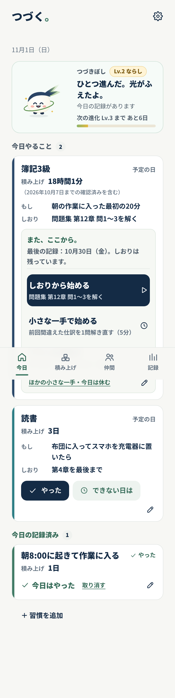
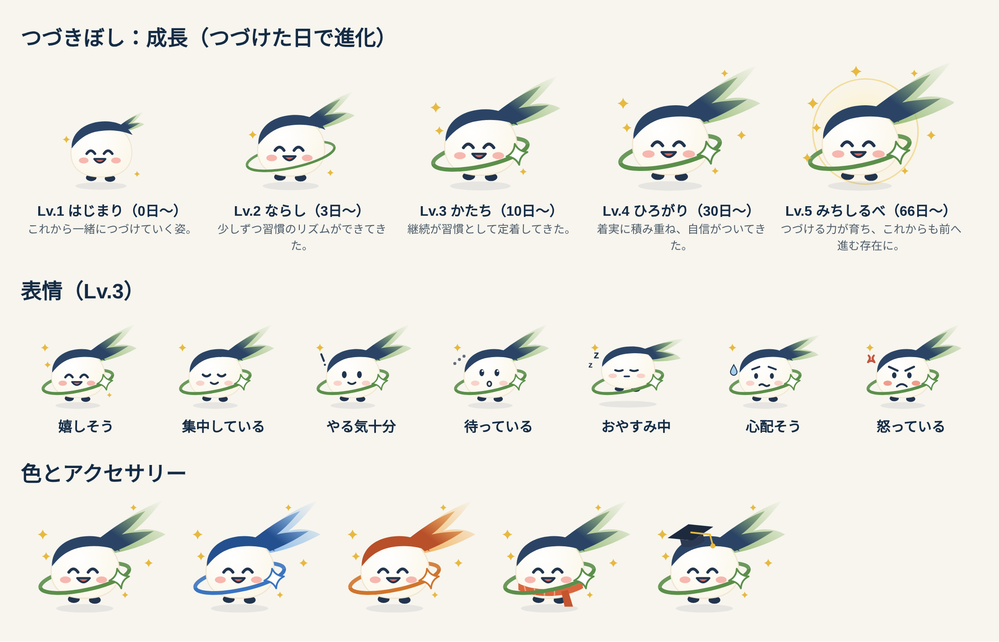

# つづく。（v7.2）

> **現在は単一端末モードです。** PC・スマホ間の同期と「仲間」は、安全に作り直すまで止めています（`VITE_SYNC_ENABLED` が `true` のビルドだけで動きます）。記録はその端末にだけ保存されます。実機での確認手順：[docs/v7/device_test.md](docs/v7/device_test.md)

止まっても、また始められる。習慣を **始める・続ける・再開する** ための日本語の PWA です。スマートフォンでも PC でも動きます。

v7 で次の4つが加わりました。

1. **積み上げが目に見える。** 時間で記録する習慣はブロック、日数で記録する習慣はタイルとして積み上がります。間があいても合計は減りません。節目に届くと一度だけ知らせます。
2. **時間か日数か、習慣ごとに選べる。** 習慣はいくつでも（12個まで）持てます。簿記はタイマーで時間を測り、読書や掃除は「やった」をワンタップで記録します。
3. **キャラクター「つづきぼし」が育つ。** 続ける力をあらわす小さな彗星です。記録だけをもとに表情が変わり、「つづけた日」が増えると Lv.1〜5 に進化します。
4. **仲間と見せ合える（任意・ログイン制）。** 招待コードで2〜8人のグループを作り、共有をオンにした習慣の「今日やったか」と積み上げを見せ合えます。スタンプは1日3回までです。ログインすると、PC とスマホも同期します。





**成長（進化）**
- 「つづけた日」で進化します。つづけた日は、やった・小さな一手の記録がある日のことで、習慣をまたいでも同じ日は1日と数えます。休むと決めた日は数えません。
- 段階は次の5つです。

| 段階 | つづけた日 |
|---|---|
| Lv.1 はじまり | 0日〜 |
| Lv.2 ならし | 3日〜 |
| Lv.3 かたち | 10日〜 |
| Lv.4 ひろがり | 30日〜 |
| Lv.5 みちしるべ | 66日〜 |

- 66日は、習慣が自動化するまでの中央値（約59〜66日）にちなんでいます。
- 段階が上がるごとに、尾が伸び、軌道の輪、輪の星、きらめき、光の輪が加わります。
- 進化した瞬間に、お祝いの画面を一度だけ出します。同じ段階を二度は祝いません。
- 今日の画面には「次の進化まで あと○日」、積み上げ画面には5段階の一覧を出します。まだ届いていない段階は影で表示します。
- 積み上げと同じく、間があいても段階は下がりません。

**見た目**
- 色は、スタンダード・ブルー・オレンジから選べます。
- アクセサリーは2つあります。
  - マフラー：12〜2月の期間限定
  - 学びの帽子：Lv.3 になるか、節目に届くと手に入ります

**表情**（`src/lib/character.ts`）

| 表情 | 出る条件 |
|---|---|
| 集中している | 計測中（一時停止中はおやすみの顔） |
| 嬉しそう | 今日やった、または節目に届いた |
| やる気十分 | 下のどれにも当てはまらない |
| 待っている | 今日が予定の日で、17時を過ぎてもまだ記録がない |
| おやすみ中 | 今日の予定の習慣を、すべて「休むと決めた」 |
| 心配そう | 予定の日に2日続けて記録がない（「ふつう」「きびしい」のとき） |
| 怒っている | 予定の日に3日続けて記録がない（**「きびしい」のときだけ**） |

- 予定のない日と、休むと決めた日は「途切れ」に数えません。
- 一手でも動けば（小さな一手を含む）、その場で嬉しい顔に戻ります。戻ってきた人を叱らないためです。
- セリフには、罪悪感をあおる言葉や人格を否定する言葉を使いません（テストで確認しています）。
- 表情はキャラクターの設定でオフにできます。

## データの原則

- **確認済みの累計 17時間36分（1,056分・2026-10-07時点）** は「簿記」の習慣1つだけが土台として持ちます。土台から個別の記録を作ることはしません。2026-10-07以前の日付は、二重に数えてしまうため簿記には記録できません。
- 初回は5つの案から選ぶだけです。架空の記録は作りません。簿記の土台を入れるかどうかも、初回の画面で選べます。
- 「休むと決めた日」は失敗として扱いません。積み上げは増えも減りもしません。
- 仲間に見えるのは、**共有をオンにした習慣の要約**（名前・今日やったか・この7日にやった日数・積み上げの合計・表情）と、表示名だけです。記録の中身・メモ・時刻・しおり・きっかけは送りません。共有は既定でオフです。詳しくはアプリ内の「プライバシー」画面を見てください。

## v6 からの移行

v6 で使っていたブラウザで開くと、最初の起動で自動的に移行します。

- v6 の単一プラン（きっかけ・しおり・小さな一手・曜日・目標時間）は、「簿記3級」の習慣1つになります。土台はそのまま引き継ぎます。
- これまでの記録はすべて簿記の記録として残ります。件数も分数も変わりません。
- 移行前のデータは端末に残っています。「設定 → 移行前のデータを書き出す」で取り出せます。
- v5/v6 のバックアップ（JSON）も、そのまま「バックアップから復元」で読み込めます。

## 起動方法（ローカル）

必要なもの：Node.js 20 以上（22 で確認）。

```bash
npm install
npm run dev          # http://localhost:5173
npm run build && npm run preview   # 本番ビルド（Service Worker・オフラインが有効） http://localhost:4173
```

共有と同期の設定をしなくても、アプリはすべて端末の中だけで動きます。その場合「仲間」タブには説明だけが出ます。

## 共有・同期を有効にする（Supabase）

**1. プロジェクトを作る**
[supabase.com](https://supabase.com) で無料のプロジェクトを作ります。リージョンは Tokyo（ap-northeast-1）がおすすめです。

**2. テーブルと権限を作る**
SQL Editor を開き、[`supabase/migrations/0001_tsuzuku_v7.sql`](supabase/migrations/0001_tsuzuku_v7.sql) の中身を貼って実行します。これでテーブル・RLS（行単位の権限）・RPC がまとめて作られます。何度実行しても安全です。

**3. メールのログインを設定する**
- Authentication → Providers で **Email** を有効にします。
- Authentication → Email Templates の「Magic Link」で、本文に **`{{ .Token }}`**（6桁のコード）が入るようにします。例：`ログインコード：{{ .Token }}（10分間有効）`
  - アプリはリンクではなくコードの入力でログインします。ホーム画面に追加した PWA でも、別のブラウザが開いてしまわないようにするためです。
- Authentication → URL Configuration の Site URL に、公開 URL（例：`https://kitatsuginaiki-cpu.github.io/tuzuku/`）を入れます。
- 無料プランの組み込みメールは送信数に制限があります。人数が増えたら Auth → SMTP Settings で自前の SMTP を設定してください。

**4. 接続先をアプリに渡す**（このリポジトリでは設定済み）
Project URL と **anon public** キーは [`.env.production`](.env.production) に書いてあります。ビルドするとアプリに組み込まれます。どちらもブラウザに配られる前提の公開してよい値で、権限はすべてサーバー側の RLS が決めます。
別のプロジェクトに切り替えるときは、このファイルを書き換えます。GitHub の Secrets（`VITE_SUPABASE_URL` / `VITE_SUPABASE_ANON_KEY`）を設定した場合は、そちらが優先されます。

> ⚠️ **service_role キーは絶対に書かない・登録しない・送らないでください。** これは RLS を無視して全データを読み書きできる鍵です。

E2E テストは `--mode e2e` でビルドします。この場合 `.env.production` を読まないので、テストが本番のサーバーに触れることはありません。

**5. 公開する**
`main` に push するか、Actions の「Deploy to GitHub Pages」を手動で実行します。これで「仲間」タブにログイン画面が出ます。

### しくみ

- **オフライン優先**：記録はまず端末に保存し、送信待ちの列（outbox）に積みます。つながったときに自動で送るので、電波がなくても記録は失われません。
- **競合の解決**：同じデータを2台で変えたときは、新しく変えた方を採用します（Last-Write-Wins）。送信待ちの変更は、受信したデータで上書きしません。
- **権限**：自分のデータは本人しか読み書きできません。仲間に見えるのは `shared_status` と `profiles` だけです。グループの作成・参加・退出は RPC 経由でのみ行い、定員8人と招待コード（10桁・約50ビット）をサーバーが確かめます。スタンプの「1日・相手ごとに3回まで」はトリガーで強制します。
- **アカウント削除**：「仲間 → アカウントを削除」で、サーバー上のデータがすべて消えます（`auth.users` からカスケード削除）。端末の記録は残ります。

## 公開（GitHub Pages）

`main` に push すると、`.github/workflows/deploy.yml` がユニットテスト・ビルド・公開まで行います。同じワークフローの中で、RLS の検証（`scripts/test-rls.sh`）も別ジョブとして実行します。

- 公開 URL：https://kitatsuginaiki-cpu.github.io/tuzuku/
- ホーム画面に追加する方法
  - iPhone：Safari で「共有 → ホーム画面に追加」
  - Android：Chrome で「アプリをインストール」
  - PC：アドレスバーのインストールアイコン

## テスト

```bash
npm test                 # ユニットテスト（Vitest）
npm run test:e2e         # E2E（Playwright・axe による監査・7つの画面幅・オフライン・仲間と同期は偽サーバーで確認）
npm run test:rls         # RLS / RPC を実際の PostgreSQL 16 で検証（要 PostgreSQL 16。Docker は不要）
node scripts/screenshots.mjs   # docs/screenshots を作り直す（preview を起動した状態で実行）
npx tsx scripts/character-sheet.tsx   # つづきぼしの一覧画像
```

結果は [docs/TEST_REPORT.md](docs/TEST_REPORT.md)、14日間の検証計画は [docs/v7/validation_plan.md](docs/v7/validation_plan.md) にあります。

## 構成

```
src/lib/model.ts        習慣（時間型／日数型）・できない日の組・全体設定・テンプレート・v6からの移行
src/lib/accumulate.ts   積み上げ（減らない合計）・ブロック・タイル・節目
src/lib/character.ts    表情のルール（CHARACTER_RULES で調整）とセリフ
src/lib/storage.ts      IndexedDB（kv / records / outbox）→ localStorage → メモリ
src/lib/sync.ts         端末間同期（outbox・LWW）と、仲間に見せる要約の作成
src/lib/remote.ts       サーバーとの境界（未設定なら端末だけで動く）
src/lib/supabaseRemote.ts  Supabase 実装（anon キーのみ）
src/screens/            今日・積み上げ・仲間・記録・習慣の編集・計測・終了・見直し・設定・プライバシー
src/components/Character.tsx  キャラクター「つづきぼし」（SVG・5段階の成長・7表情・色とアクセサリー）
src/components/LevelUp.tsx    進化の瞬間のお祝い
supabase/migrations/    テーブル・RLS・RPC
supabase/tests/         RLS の検証 SQL
tests/unit, tests/e2e   （tests/e2e/fakeRemote.ts は E2E 用の偽サーバー）
```

## 調整できる値

| 値 | 場所 |
|---|---|
| 表情のしきい値（待つ時刻 17時・心配 2日・怒る 3日） | `CHARACTER_RULES`（`src/lib/character.ts`） |
| 節目（時間・日数） | アプリの設定画面 |
| 1日の区切り（0〜4時） | アプリの設定画面 |
| ブロック1つの分数 | `blockMinutes`（既定は30分） |
| 再開を出すまでの日数 | `RESUME_GAP_DAYS`（`src/lib/config.ts`） |
| スタンプの上限・グループの定員 | `src/lib/remote.ts` とマイグレーション SQL の両方 |
