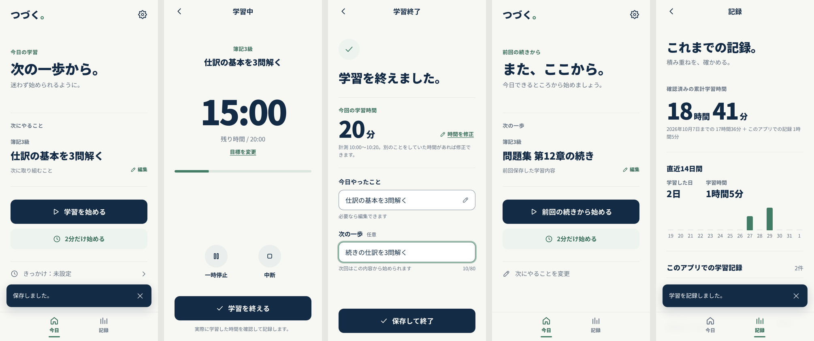

# つづく。（v5）

止まっても、また始められる。— 学習を **始める・続ける・再開する** ための日本語PWA。
スマートフォン・PC の両方で動作し、ログイン不要・データは端末内にだけ保存します。



## できること

| 画面 | 内容 |
|---|---|
| 今日 | 「次にやること」1件と「学習を始める」。未設定でも開始可。「2分だけ始める」（目標2分）。きっかけ（任意1文） |
| 再開 | 最後の実記録から2日以上空くと「また、ここから。」に切り替え、「前回の続きから始める」 |
| 学習中 | 残り時間・目標・進捗バー（数値と一致）。一時停止／再開、中断（記録して終了／記録せず終了／戻る）、目標時間の変更 |
| 学習終了 | 実時間（保存前に修正可）、今日やったこと（自動入力）、次の一歩（任意・80字）→「保存して終了」 |
| 記録 | 確認済み累計（2026-10-07時点 17時間36分 ＋ 新しい記録）、記録の一覧・追加・編集・削除（元に戻す可）、実記録がある時だけ直近14日の集計 |
| 設定 | 学習対象・次にやること・きっかけ・既定の目標時間、JSONバックアップ／復元、v3.1 からの移行、記録の消去 |

**データの原則**：17時間36分（1,056分）は「基準値」としてのみ保持し、個別の記録は0件から始まります。2026-10-07以前の日付の記録は二重計上になるため入力・取り込みできません。

## 起動方法（ローカル）

必要なもの：Node.js 20 以上（22 で確認）

```bash
npm install
npm run dev          # 開発サーバー  http://localhost:5173
```

本番ビルドを確認する場合（Service Worker・オフラインはこちらで有効）：

```bash
npm run build        # 型チェック + dist/ を生成（sw.js も自動生成）
npm run preview      # http://localhost:4173
```

同じ Wi‑Fi のスマホから試す場合は `npx vite preview --host` で表示される `http://192.168.x.x:4173` を開きます。ただし **HTTP では Service Worker（オフライン・ホーム画面追加）は動きません**（localhost 以外は HTTPS が必要）。

## 公開方法（静的ホスティング）

`npm run build` で生成される `dist/` フォルダを、HTTPS の静的ホスティングにそのまま置くだけで動きます。パスは相対指定なので、サブパス（例：`https://<user>.github.io/tsuzuku/`）でも動作します。

- **GitHub Pages（おすすめ・自動）**：GitHub で空のリポジトリ（例：`tsuzuku`）を作る → このフォルダを push する → リポジトリの Settings → Pages → Source を **GitHub Actions** にする。以降は `main` に push するたびに `.github/workflows/deploy.yml` がテスト・ビルド・公開を行い、`https://<ユーザー名>.github.io/tsuzuku/` で使えます。
  ```bash
  git init && git add . && git commit -m "つづく。v5"
  git branch -M main
  git remote add origin https://github.com/<ユーザー名>/tsuzuku.git
  git push -u origin main
  ```
  ※ 公開リポジトリにはソースコードのみが含まれます。学習記録は各端末のブラウザ内にあり、リポジトリには入りません。
- **Netlify / Cloudflare Pages**：ビルドコマンド `npm run build`、公開ディレクトリ `dist`。

- **Claude の Artifact（すぐ試す用）**：`npm run build && node scripts/build-artifact.mjs` で `artifact/` を作り、Claude から公開しています（作者専用の非公開ページ）。Artifact 上では **オフライン起動（Service Worker）とファイルのダウンロードが使えない** ため、バックアップは 設定 →「バックアップをコピー」「貼り付けて復元」を使います。

公開後：
- **iPhone（Safari）**：公開URLを開く → 共有 → 「ホーム画面に追加」
- **Android（Chrome）**：公開URLを開く → メニュー → 「アプリをインストール」または「ホーム画面に追加」
- **PC（Chrome / Edge）**：アドレスバーのインストールアイコン（対応ブラウザでは アプリの 設定 画面にも「ホーム画面に追加」ボタンが出ます）

> ⚠️ データは「その端末・そのブラウザ・その公開URL」ごとに保存されます（Artifact 版と GitHub Pages 版も別々です）。**PCとスマホは自動では同期されません。** 端末やURLを移る場合は 設定 →「バックアップを書き出す」または「バックアップをコピー」→ もう一方で「バックアップから復元」または「貼り付けて復元」。ブラウザのデータ削除やプライベートブラウズでは消えることがあるため、ときどきバックアップしてください。

## v3.1 試作版からの移行

- v3.1 のバックアップJSON（`tsuzuku-backup-*.json`, `format: tsuzuku-v3`）を 設定 → 「バックアップから復元」で読み込むと、取り込む記録を選ぶ画面が出ます。
- v3.1 と同じURLで公開した場合は、設定画面に「以前の試作版のデータが見つかりました」と表示されます。
- どちらも **自動では取り込みません**。2026-10-07以前の記録・不正な記録は除外されます（v3.1 の使用ログ `events` は取り込みません）。

## テスト

```bash
npm test             # ユニットテスト（Vitest）
npx playwright install chromium   # 初回のみ（ブラウザ未導入の環境）
npm run test:e2e     # E2E（Playwright。ビルド済み dist をプレビューして実行。axe によるアクセシビリティ監査を含む）
node scripts/screenshots.mjs      # 主要画面のスクリーンショット（preview 起動中に実行）
```

実施結果は [docs/TEST_REPORT.md](docs/TEST_REPORT.md)、設計判断と旧版の監査は [docs/AUDIT_AND_DESIGN.md](docs/AUDIT_AND_DESIGN.md)。

## 構成

```
src/
  lib/config.ts     基準値（1,056分・2026-10-07）、再開しきい値 RESUME_GAP_DAYS=2、文字数上限
  lib/session.ts    タイマーの状態機械（running / paused / completing）— 時刻差で計算
  lib/records.ts    記録の型・検証・累計・ホーム状態・14日集計
  lib/backup.ts     JSON 書き出し／読み込み、v3.1 移行
  lib/storage.ts    IndexedDB（records / kv ストア、原子的な保存）→ localStorage → メモリの順に利用
  store.tsx         画面状態と操作（保存状態・通知・タブ間同期）
  screens/          今日・学習中・学習終了・記録・設定
  sw-template.js    Service Worker（ビルド時にプリキャッシュ一覧を埋め込み）
tests/unit, tests/e2e
```

依存パッケージ（実行時）：React / React DOM のみ。解析・広告・外部フォント・外部通信はありません。

## 調整できる値

- 再開判定の日数：`src/lib/config.ts` の `RESUME_GAP_DAYS`
- 既定の目標時間：アプリの 設定 画面（初期値 20分）
- 文字数上限：`LIMITS`（次の一歩 80字 など）

## 将来のクラウド同期に向けて

記録は ID・`updatedAt` 付きの独立したレコード、設定は単一ドキュメントとして保存しているため、将来サーバー同期を足す場合も `Repository` インターフェース（`src/lib/storage.ts`）の実装を追加する形で拡張できます。今回のMVPには含めていません。
