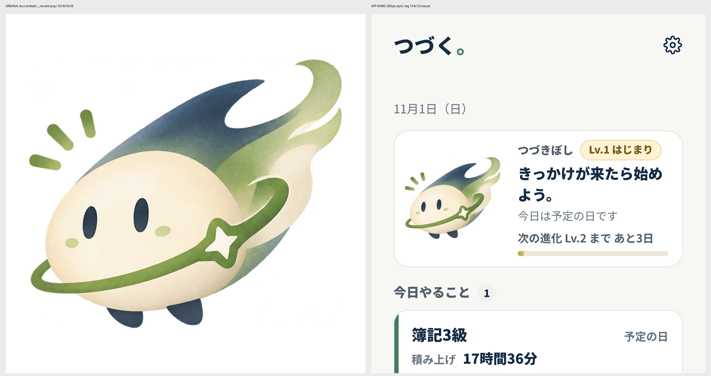

# テスト結果

## v7.3（2026-11-03）キャラクターを提供された PNG に置き換え

**やったこと**
- 現在 SVG で描いていたキャラクターを、提供された PNG（5体×7表情＝35枚）の直接表示に置き換えた。`public/assets/characters/{キャラ}__{表情}.png`。新しく生成・模写・SVG で作り直した絵はない（SVG の描画コードと、SVG で作った一覧画像は削除）。
- 手順は指示どおり。①35枚の存在と読み込みを確認 ②つづきぼしの通常表情だけをホームに出して元画像と比較 ③35枚すべてにアプリ経由でアクセスできることを確認 ④残りのキャラクター選択と表情の切り替えを実装。
- 色・アクセサリーの切り替えは SVG で絵を描き変える機能だったため外した。設定の `charaColor` / `charaAccessory` は `charaKind`（既定 つづきぼし）に置き換えた。古い設定値は読み込み時に捨てる。記録には影響しない。

**確認した結果**

| 確認 | 方法 | 結果 |
|---|---|---|
| 35枚が存在する | ダウンロードフォルダの zip を展開し、`manifest.json` の sha256 と照合 | 35/35 一致。PNG・RGBA・四隅は透明 |
| 加工せずに配置した | 配置後の `public/assets/characters/` を manifest と照合（ユニットテストで常時確認） | 35/35 一致 |
| ホームの通常表情が元画像そのもの | プレビューで配信されたファイルの sha256 を元画像と比較。スクリーンショットを並べて目視 | sha256 一致（`388736f2…d094`）。縮小表示（1024px→124px）のため、元画像を同じ大きさに縮めた画像との平均画素差は約3.6/255。縮小のしかたの違いによるもので、絵は同じ |
| 35枚すべてにアクセスできる | ビルドしたアプリのサーバーから35枚を取得し、状態・型・sha256・デコードしたサイズを確認 | 35/35：200・image/png・sha256 一致・サイズ一致 |
| 5体×7表情が画面で切り替わる | E2E：設定で5体を順に選び、表情の一覧の7枚がすべて読み込まれる（naturalWidth>0）。今日の画面の絵が選んだキャラになり、「やった」で happy に変わる | 合格 |
| 表情の対応 | E2E：しょんぼり（2日あく）・再スタート（間をあけて記録）・やるぞ（17時過ぎ）・ふつう・集中（計測中）・おやすみ（一時停止） | 合格 |
| 積み上げ・終了・お祝いの画面 | E2E：画像が読み込まれる。未到達の段階は同じ素材を CSS で薄く表示 | 合格 |

**テストの結果**
- ユニット：104件 合格（素材の sha256 照合、表情→PNG の対応、すべての表情が使われること、再スタートの判定を追加）
- E2E：86件 合格・1件スキップ（desktop 専用のテスト）
- RLS：合格（変更なし）
- 型チェック：エラーなし

**途中で見つけて直したこと**
- E2E のセレクタ「やさしい」が、つづねこの説明文「まじめでやさしい猫の相棒」にも当たっていた → 先頭一致に変更。
- 消去の確認ダイアログが閉じきる前に通知を閉じようとして、あとから出た通知がタブを覆うことがあった（テスト手順側の競合） → タブを押す前にダイアログが閉じるのを待つようにした。
- 4並列で実行するとタイマーを進めるテストが時間切れになった。画像のあり・なしで時計を10分進める時間を測ると 2.57 秒と 2.57 秒で同じだった。画像の負荷ではなく、2コアの環境で並列を増やしたためと判断し、既定の並列数で全件合格を確認した。

**素材について気づいたこと（素材は変えていません）**
- ふつう（neutral）の7枚は 1024×1024・約0.4〜0.8MB、ほかは 512×512。初回の読み込みはやや重くなる。軽くしたい場合は、こちらで縮小せず、縮小版の素材を用意してもらう必要がある。
- つづとりの一部など、絵が画像の端に触れている素材がある。
- 段階（Lv）ごとの絵と「怒る」絵はない。段階はバッジと進み具合で示し、「怒る」は「やるぞ（determined）」を使う。

**実機では未確認**
- iPhone・Android での表示と、オフラインでの表示（つづきぼしの7枚は最初に保存、ほかは表示したときに保存）は、device_test.md の T9 で確認してもらう。

## v7.2（2026-11-02）今日の画面の並び・再開・休みの見直し・見直しは習慣ごと・通知の位置

| 種類 | 件数 | 結果 |
|---|---:|---|
| 型チェック | — | エラー 0 |
| ユニット | 103 | **103 件すべて合格**（追加 13件） |
| E2E | 86 | **86 件すべて合格**（追加 10件）。axe は動きを止めた状態で監査し、4回くり返して4回とも合格 |
| axe（WCAG 2.2 A/AA） | 26 画面・状態 | **違反 0** |

### 変更点
1. **今日の画面の並び**
   - 上から「今日やること」（今日が予定の日で、まだ記録がない）→「予定のない習慣」→「今日の記録済み」の順にしました。
   - 記録済みの日数型のカードは、小さく表示します。
   - 全部終わったら「今日の予定はすべて記録しました。」と出します。
   - 計測中の習慣は「今日やること」に置きます。
2. **再開の導線**
   - 前回の記録から2日以上あき、そのあいだに予定の日が1日以上あった習慣のカードに、「また、ここから。」と前回の日付を出します。
   - あわせて、3つの選択肢を出します：しおりから始める（日数型は「やった」）／小さな一手で／プランを見直す。
   - まだ一度も記録していない習慣には出しません。予定のない日しか挟んでいない場合も出しません。
3. **休みが続いたとき**
   - 予定の日に「休む」が3日続いたら、責めずに見直しを案内します（予定の曜日を見直す／一手を小さくする／このままでいい）。
   - キャラクターの表情は変えません（罰にしないため）。
   - 「このままでいい」で閉じたら、同じ休みが続いている間は、さらに4日続くまで出しません。
4. **週の見直しを習慣ごとにしました。**
   - 1つの習慣を見直しても、ほかの習慣の見直し時期は変わりません。「今週はしない」も、選んだ習慣だけに効きます。
   - v7.1 以前に全体で見直した日は、各習慣の初期値として引き継ぎます。
5. **通知の位置**
   - スマホ：下のタブの位置（タブのない画面では上のバーの位置）に、一時的にかわって出します。本文のボタンには重なりません。表示は1件ずつで、2行を超える部分は省きます（読み上げでは全文を読みます）。
   - PC：左のナビ列の下に出します。
   - 節目の知らせは、あとから来たふつうの通知に隠されません。

### 確認した内容
- **ユニット**
  - 今日の並び。
  - 再開の判定：2日あき・予定の日あり・一度も記録していない・予定のない日だけ・休んだ翌日。
  - 休みが続いた数：予定のない日は飛ばして数える。
  - 案内を出すかどうか：3日／閉じたあと／新しく休みが続いたとき。
  - 見直しが習慣ごとに働くこと：前回の見直し・今週はしない・v7.1 以前の値の引き継ぎ・あとから追加した習慣。
- **E2E**
  - 5つの習慣で、並びと記録後の移動、全部終わったときの表示。
  - 予定外の日のまとまり。
  - 再開の3つの選択肢と、それぞれの行き先。
  - 休みが3日続いたときの案内と、曜日の欄へ移ること、閉じたあと再読み込みしても出ないこと。
  - 読書だけ見直したあとも、簿記の見直しが残ること。
- **通知の位置**：5つの画面幅（320・390・768・1024・1440px）で確認しました。
  - スマホの幅：今日の画面（先頭／いちばん下までスクロール）と記録画面で、通知がバーの中に収まり、本文にはみ出さないこと。
  - PC の幅：通知がどの操作とも重ならないこと。

### トレードオフ
スマホでは、通知が出ている数秒（取り消しのある通知は8秒）のあいだ、下のタブが通知に置き換わります。通知の × を押せば、すぐにタブへ戻ります。

---

## v7.1.1（2026-11-02）単一端末モード（安全性の修正）

| 種類 | 件数 | 結果 |
|---|---:|---|
| 型チェック | — | エラー 0 |
| ユニット | 90 | **90 件すべて合格**（TZ が Asia/Tokyo・America/Los_Angeles のどちらでも合格） |
| E2E（テスト用ビルド） | 76 | **76 件すべて合格** |
| E2E（**本番と同じビルド**・`.env.production` あり）：安全性・移行・通常フロー・オフライン | 38 | **38 件すべて合格**（Supabase への通信 0 件） |
| RLS（PostgreSQL 16） | — | 合格 |
| axe（WCAG 2.2 A/AA） | 26 画面・状態 | **違反 0**（保存の警告・iPhone の案内・直前の状態の表示を追加） |
| `npm audit --omit=dev` | — | 0 |

### 変更点
1. **同期と「仲間」を本番で停止しました。**
   - `VITE_SYNC_ENABLED=true` でビルドしない限り、サーバーへの通信も、送信待ち（outbox）の作成もしません。
   - 以前のログイン情報が端末に残っていても同じです。
2. **消去・復元を「この端末だけ」の操作にしました。**
   - 消去や復元をしても、サーバーへ削除を送りません。
   - 将来同期を再開しても、端末で消したことがほかの端末に伝わらない作りになっています。
3. **消去・復元の直前の状態を、端末に自動で1つ残すようにしました。**
   - 設定の「直前の状態に戻す」で取り消せます。
4. **保存についての警告を、今日の画面に出すようにしました。**
   - 保存できない（メモリだけ）とき：閉じられない警告を出します。
   - iPhone の Safari で開いたままのとき：ホーム画面への追加を案内します。閉じると14日間は出しません。
5. **設定画面に「最後のバックアップ」の日時と、アプリのバージョン（例：7.1.1 とコミットの番号）を表示しました。**

### 確認した内容
- **同期の停止**：ログイン情報を残した状態で記録・削除・元に戻す・仲間タブを操作しても、outbox は0件、Supabase への通信は0件でした。本番と同じビルドで確認しています。
- **消去と直前の状態**
  - 消去したあとも outbox は0件でした。
  - 「直前の状態に戻す」で、習慣・記録・積み上げ（18時間1分）・今日の「やった」が元どおりになりました。
- **保存の警告**
  - IndexedDB と localStorage を使えなくすると、警告が出て、習慣を作ったあとも出続けました。
  - iPhone の Safari を再現した環境では案内が出て、閉じると再読み込み後も出ませんでした。PC の画面では出ませんでした。
- **バックアップ**：書き出すと「最後のバックアップ」が記録され、再読み込み後も残っていました。バージョンも表示されました。
- **移行（実際の Chromium の IndexedDB で確認）**
  - 記録0件の v6 は、移行後も **17時間36分** のままでした。
  - 記録がある場合は、件数と分数がそのまま引き継がれました。
  - 移行前のデータの書き出しが元の記録と一致し、2回目の起動で移行し直しませんでした。
- **ユニットテスト**
  - 基準値は 1,056分（2026-10-07）で、簿記の習慣だけが持つことを確認しました。
  - 移行で、記録の件数と分数の合計が変わらないことを、50通りの入力で確認しました。
  - 何も操作していない v6 では、習慣も記録も作られないことを確認しました。

### 40分の差（18時間16分）について
- 前回の報告に出た「18時間16分」は、**私が調査のために作ったテスト用の記録（10/30・40分「講義#12」）を足した結果**です。
  - この記録は、手元の自動テスト用ブラウザの中だけで作り、テストが終わると消えました。
  - 公開中のサイトや、あなたの端末のデータには触れていません。この作業環境からは公開サイトにも接続できません。
- アプリの中で、基準値に分数を足すのは「本人が保存した記録」だけです（`habitTotal`）。記録を作るのは次の4か所だけで、基準値から記録を作るコードはありません。
  - 計測の保存
  - 日数型の「やった」「休む」
  - 記録画面での手入力
  - バックアップの取り込み
- 今回、移行のテストを常設しました（`tests/e2e/migration.spec.ts`）。テスト用の記録は名前を「テスト用 …」にして、実データと区別しています。
- 実機の値は、実機テスト手順の **T0** で確認します。17時間36分より多い場合は、操作せずに知らせてもらう手順にしています。

### 未確認（v7.1.1）
- iPhone・Android の実機での動作（`docs/v7/device_test.md` で確認する）。
- iPhone で、Safari とホーム画面のアプリのあいだで保存が分かれるかどうか（手順で、どちらでも困らないようにしています）。
- 同期（停止中）。再開の前に、本物の Supabase で確かめることを条件にします。

---

## v7.1（2026-11-01）つづきぼし：成長と進化

キャラクターを、本人のデザイン案 A「つづきぼし」に変えました。

| 種類 | 件数 | 結果 |
|---|---:|---|
| 型チェック | — | エラー 0 |
| ユニット | 87 | **87 件すべて合格**（追加 5件） |
| E2E | 67 | **67 件すべて合格**（追加 4件） |
| axe（WCAG 2.2 A/AA） | 23 画面・状態 | **違反 0**（進化のお祝い・成長の段階を追加） |

**追加したテスト**
- **成長**
  - 段階は「つづけた日」で決まる。同じ日は1日、休みは数えない。
  - しきい値は 0・3・10・30・66 日。
  - Lv.5 では「次」がない。
- **お祝い**
  - 3日目の記録で Lv.2 のお祝いが出る。
  - 取り消してからもう一度記録しても、再読み込みしても、同じ段階は二度祝わない。
- **積み上げ画面**：到達した段階と、未到達の段階（影で表示）が出る。
- **表情**
  - 計測中は「集中」、一時停止中と、休むと決めた日は「おやすみ」になる。
  - 仲間へは、サーバーが受け付ける5種類に丸めて送る。
- **アクセサリー**
  - マフラーは11月には使えない。
  - 学びの帽子は、25時間の節目に届くと使えるようになる。
  - 色を変えられる。

## v7（2026-11-01）積み上げ・時間／日数・キャラクター・仲間

実行環境は v6 と同じです（Linux、Node.js 22、Chromium（Playwright 1.63）、ja-JP、Asia/Tokyo、本番ビルド）。RLS は PostgreSQL 16 で実行しました。

| 種類 | 件数 | 結果 |
|---|---:|---|
| 型チェック（strict） | — | エラー 0 |
| ユニット（Vitest） | 81 | **81 件すべて合格**（TZ が Asia/Tokyo でも America/Los_Angeles でも合格） |
| E2E（Playwright） | 63 | **63 件すべて合格** |
| RLS / RPC（PostgreSQL 16・`supabase/tests/rls_test.sql`） | 8 群・約40項目 | **すべて合格** |
| アクセシビリティ自動監査（axe-core・WCAG 2.2 A/AA） | 21 画面・状態 | **違反 0** |
| `npm audit --omit=dev` | — | 脆弱性 0 |

### v7 で追加・変更したテスト

**ユニット**
- 積み上げ
  - 基準値1,056分は簿記の習慣だけが持つことを確認した。
  - ブロックは土台を先に積み、端数も正しく出ることを確認した。
  - 日数型は重複のない日数で数え、小さな一手は1日に数え、休みは数えないことを確認した。
- 節目：越えたときに1回だけ判定されることを確認した。
- 表情
  - 5つの表情の条件を確認した。
  - 「怒る」は「きびしい」設定のときだけ出ることを確認した。
  - 再開の画面では怒らないこと、一手で嬉しい顔に戻ることを確認した。
  - 休むと決めた日・予定のない日・使い始める前の日は「途切れ」に数えないことを確認した。
  - しまった習慣は数えないことを確認した。
  - セリフに禁止語（ダメ・失敗・サボ など）が入っていないことを確認した。
- 同期
  - 仲間に送る要約に、メモ・時刻・しおりが入らないことを確認した。
  - キャラクターをオフにすると、表情も送らないことを確認した。
  - LWW：新しい方を採用し、古いものは無視することを確認した。送信待ちのものは上書きしない。削除の印（tombstone）は反映される。
  - 受信しても、基準値を持つ習慣が2つにならないことを確認した。
  - SyncEngine：送信 → 送った分だけ outbox から消す → 受信 → 要約の公開、の順に動くことを確認した。
  - 通信に失敗したら outbox を残すことを確認した。
- 移行：v6 の DB（version 1）を開いたとき、次のことを確認した。
  - version 2 に上げ、`outbox` ストアを追加する。
  - 単一プランを簿記の習慣（基準値つき）にする。
  - 記録に `habitId` を付ける。件数と分数は変えない。
  - 移行前のデータを保存する。
  - 2回目は移行しない。
  - 一度も使っていない v6 では習慣を作らない。
- バックアップ：schema 3 で往復できること、v1/v2 の読み込みで簿記の習慣に移行することを確認した。

**E2E（`flows`・`behavior`・`friends`・`a11y`・`responsive`・`offline`）**
- 初回
  - 5つの案から選ぶだけで始められ、架空の記録は作らないことを確認した。
  - 基準値を含めない選択もできることを確認した。
- 時間型（計測・一時停止・中断・復元・二重送信の防止・保存失敗時の入力保持・手動の記録・編集・削除・取り消し）：v6 と同じ観点を、複数の習慣の上でもう一度確認した。
- 日数型
  - ワンタップで記録できること、通知とカードの両方から取り消せること、1日1件までであることを確認した。
  - 過去の日も記録できることを確認した。
- できない日の組
  - 日数型では、選ぶとそのまま「小さな一手」として記録されることを確認した。
  - 時間型では、目安の分数で計測が始まり、メモに「こんな日は：…」が残ることを確認した。
  - 休むと決めた日は、積み上げに数えず、タイルが斜線になることを確認した。
- 習慣
  - 追加・検証・編集ができることを確認した。
  - 記録がある習慣は、記録のしかたを変えられないことを確認した。
  - しまっても記録が残り、積み上げ画面に表示されることを確認した。
- 積み上げ
  - ブロックの数を確認した（35個が土台）。
  - 25時間の節目の通知が1回だけ出て、削除して戻しても再通知されないことを確認した。
  - タイルと「次の節目まで」の表示を確認した。
- キャラクター
  - 実際に1週間あけた状態で、ふつうは心配、きびしいは怒る、やさしいは待っている、になることを確認した。
  - 一手を打つと嬉しい顔になることを確認した。
  - オフにできること、設定画面に5つの表情が並ぶことを確認した。
- 週の見直し：習慣ごとに選べて、選んだ習慣の該当する欄へフォーカスが移ることを確認した。
- 1日の区切り：3時に設定すると、深夜1時半の記録は前の日になることを確認した。
- 仲間（偽サーバーで、2〜3台の端末を同時に動かす）
  - 招待コードで参加できること、誤ったコードではエラーになることを確認した。
  - 共有しているのが1つの習慣だけなら、仲間に見えるのもその1つだけであることを確認した。
  - メモ・時刻・しおりが画面にも送信データにも出ないことを確認した。
  - スタンプは3回で止まること、自分には送れないこと、相手に届くことを確認した。
  - 共有をオフにすると消えること、抜けられること、定員は8人であることを確認した。
- 端末間の同期
  - スマホの習慣と記録が PC に届くこと、PC での変更がスマホに戻ることを確認した。
  - オフラインで記録しても、つながると自動で送られることを確認した。
- アカウント削除
  - サーバー上のデータが消え、端末の記録は残ることを確認した。
  - 確認の入力（「削除」）がないと実行できないことを確認した。
- 接続先が未設定のとき：説明とプライバシー画面だけが出ることを確認した。
- 7つの画面幅（320・375・390・430・768・1024・1440px）
  - 5つの習慣があっても横スクロールが出ないことを確認した。
  - 4つのタブが画面の中に収まることを確認した。
  - 文字を200%にしても崩れないことを確認した。
  - reduced motion のとき、キャラクターのアニメーションも止まることを確認した。
- オフライン：Service Worker で起動し、時間型・日数型の両方を記録して、再読み込み後も残ることを確認した。
- PC の3カラム：補助欄に積み上げと7日間の日数が出ることを確認した。

**RLS（実際の PostgreSQL 16。auth は最小限の代用品）**
- `user_data`
  - 本人だけが読み書きできることを確認した。
  - 他人の user_id では書けないことを確認した。
  - LWW と削除の印が効くことを確認した。
- グループに入る前は、他人の共有もプロフィールも見えないことを確認した。
- グループ
  - 直接 INSERT はできない（RPC だけ）ことを確認した。
  - 招待コードは10桁で、小文字でも参加できることを確認した。
  - 誤ったコードは not_found になることを確認した。
- 参加したあとも、相手の生データは読めない（共有の要約だけ見える）ことを確認した。
- 無関係のユーザーには何も見えないことを確認した。
- スタンプ
  - 3回までであることを確認した。
  - なりすましができない、グループ外には送れない、更新できないことを確認した。
  - 決められた種類以外は送れないことを確認した。
- 定員は8人であることを確認した。
- 共有をオフにすると消えること、退出したあとは見えないことを確認した。
- アカウント削除で、関連するデータがカスケードで消えることを確認した。ほかの人がいるグループは残る。
- anon は表を読むことも RPC を呼ぶこともできないことを確認した。

### v7 で見つけて直した不具合
1. 積み上げの日数タイルで、使い始める前の日まで「予定の日・記録なし」の枠で表示されていました。できなかった日に見えてしまうため、始める前の日は区別して表示するようにしました。
2. 補足の文字のコントラストが 4.5:1 を下回っていました（タイル、選択中の項目、仲間の状態）。色を直しました。
3. 共有のスイッチと設定の切り替えが、保存が終わるまで画面に反映されませんでした。押した時点で反映し、保存に失敗したら元に戻すようにしました。
4. 習慣カードの「できない日は」ボタンが横いっぱいに広がっていました。また、色の指定が順序のせいで上書きされていました。どちらも直しました。
5. RLS の検証で、Supabase は既定で anon にも RPC の実行権限を与えることが分かりました。すべての RPC から anon の実行権限を外しました。

### 未検証（v7）
- **本物の Supabase とのつなぎ込み。** 接続先の URL とキーがまだないため、未実施です。メールのコード送信、トークンの更新、PostgREST の応答形式は確認できていません。設定したら README の手順で、2台を使ってログイン・グループ・同期を確かめます。
- iPhone / Android の実機、Safari・Firefox、VoiceOver / TalkBack。
- 同期は LWW なので、2台でほぼ同時に同じ記録を編集すると、後に保存した方が残ります（項目単位の結合はしていません）。
- 行動変容の効果（[docs/v7/validation_plan.md](v7/validation_plan.md)）。

---

## v6（2026-11-01）行動変容の再設計

実行環境：Linux（クラウド）、Node.js 22、Chromium（Playwright 1.63）、ja-JP、Asia/Tokyo。対象：本番ビルド（`vite preview`）。

| 種類 | 件数 | 結果 |
|---|---:|---|
| 型チェック（strict） | — | エラー 0 |
| ユニット（Vitest） | 49 | **49 合格**（TZ = Asia/Tokyo・America/Los_Angeles） |
| E2E（Playwright, Chromium） | 51 | **51 合格**（＋1 は desktop 専用の mobile 側スキップ） |
| アクセシビリティ自動監査（axe-core, WCAG 2.2 A/AA） | 14 画面・状態 | **違反 0**（プラン・週の見直し・再開を追加） |
| `npm audit` | — | 脆弱性 0 |

### v6 で追加したテスト
| 項目 | 内容 |
|---|---|
| プラン | 1画面で きっかけ・しおり・小さな一手・曜日 を設定 → ホームに if-then の文として表示、再読み込み後も保持、プレビューが入力に追従 |
| しおり | しおりから開始（記録に「しおりから」）、終了時の候補「続き：／解き直し：」、保存直後の表示 |
| きっかけ通りの質問 | 任意。答えずに保存できる／「はい」が記録される／記録中心モードでは出さない |
| 小さな一手 | 本人の一手と分数で開始、時間到達で自動完了しない、延長は任意、終了時にしおりが残る、未設定なら「2分だけ」 |
| 再開 | 3択（しおりから／小さな一手／プランを1つ変える）、空白日数・失敗の文言を出さない、プランへ移動 |
| 週の見直し | 記録あり＋7日経過で提案、事実のみ表示（予定日は利用開始日以降のみ数える）、未選択では保存不可、選んだ欄へフォーカス、「今週はしない」で7日非表示、見直しは端末内に保存 |
| 記録中心モード | 切替で簡素なホーム、戻せる |
| 移行 | v5 の設定・進行中セッション（two_minute）・バックアップ v1 を v6 で読める |
| 具体化のヒント | 曖昧な一手でヒント表示、具体的なら非表示、保存は妨げない |

### v6 で見つけて直した不具合
1. 設定の切替（ラジオ）が保存完了まで画面に反映されなかった → 即時反映し、失敗時に戻す。
2. 再開画面で週の見直しが出なかった → 表示。
3. PC 補助欄・見直しで、利用開始前の日を「予定日のうち0日」と数えていた → 利用開始日以降のみ。
4. しおり候補の不自然な日本語、再開画面のしおり重複、「2分だけ（2分）」の重複、小さな一手の後にしおりが消える、曜日チップの折り返し → 修正（03_ux_design.md）。

### 未検証（v6）
- iPhone / Android 実機、Safari・Firefox（エンジンをこの環境で取得できない）、VoiceOver / TalkBack。
- 行動変容の効果そのもの（04_validation_plan.md の14日検証で確認する。1人・14日では因果は判断できない）。
- 「開いてから開始まで」の秒数は、アプリが画面に出た時刻からの計測で、別アプリから戻った直後などの文脈は区別できない。

---

## v5（以前の記録）

実行環境：Linux（クラウド）、Node.js 22、Chromium（Playwright 1.63）、ロケール ja-JP、タイムゾーン Asia/Tokyo。
対象：`npm run build` で生成した本番ビルド（`vite preview`）。

## 結果サマリー

| 種類 | 件数 | 結果 |
|---|---:|---|
| 型チェック（`tsc -b`, strict） | — | エラー 0 |
| ユニットテスト（Vitest） | 33 | **33 合格**（TZ = Asia/Tokyo・America/Los_Angeles・UTC の3通りで実行） |
| E2E（Playwright, Chromium） | 40 | **40 合格**（＋1 は desktop 専用テストの mobile 側スキップ） |
| 自動アクセシビリティ監査（axe-core, WCAG 2.2 A/AA） | 10画面・状態 | **違反 0**（E2E 40件に含む） |
| 依存パッケージ監査（`npm audit`） | — | 脆弱性 0 |

E2Eは Playwright の仮想時計（`page.clock`）で時刻を止め、`runFor()` で明示的に進めています。タイマー・バックグラウンド復帰・再読み込み復旧を実時間待ちなしで決定的に検証するためです。

## 要求されたテスト項目との対応

| 要求項目 | テスト |
|---|---|
| 初回空状態 | 未設定でも開始可、0件、空状態文言、グラフ非表示、架空の数値なし |
| 通常開始 | ワンタップ開始 → 15:00 / 進捗25% の整合 → 保存 → 次の一歩がホームへ |
| 2分開始 | 2分経過後も自動完了せず、経過表示へ。目標を20分に延長。記録0件のまま |
| 一時停止／再開／中断／終了 | 一時停止中は進まない、一時停止時間を除外、中断の3択、記録せず終了の取り消し |
| バックグラウンド復帰 | 非表示中に9分経過 → 復帰時に正しい表示＋「離れていた約9分」通知 |
| 再読み込み復帰 | 実行中・一時停止中ともにリロード後に同じ時間で復旧 |
| 保存二重送信 | 3連打しても記録1件（UI のロック＋ID による冪等保存。ユニットでも同時実行を検証） |
| 保存失敗 | IndexedDB 書き込みを強制失敗 → 仕様文言のエラー、入力保持、再試行で保存 |
| 編集・削除・累計再計算 | 追加 18:06 → 編集 18:21 → 削除 17:36 → 元に戻す 18:21 → 再読込後も一致 |
| 基準値との整合 | 基準値のみで 17時間36分。2026-10-07 以前の日付は入力・復元・移行のすべてで拒否 |
| JSON書き出し・復元 | 書き出し内容を検証 → 全消去（基準値は残る）→ 復元で同じ累計 |
| 不正入力・長文 | 81字エラー、0分・1441分・未来日・101字、壊れたJSON、基準値違いのJSON、HTML文字列（実行されない） |
| 未確認ログ非表示 | 初期表示で「連続」「再開回数」等の文言・記録・グラフがないこと |
| オフライン | SW 制御後にネットワーク遮断 → リロードで起動 → 学習を保存（mobile/desktop） |
| レスポンシブ7幅 | 320/375/390/430/768/1024/1440px：今日・記録・設定・学習中・学習終了で横スクロールなし、主CTAが表示内、ナビの切替 |
| キーボード操作 | Tab で主CTAへ到達・フォーカスリング表示・Enter で開始・Space で一時停止・Esc でダイアログを閉じフォーカスが戻る |
| アクセシビリティ自動監査 | 今日（未設定／設定済み）、各ダイアログ、学習中、一時停止中、学習終了、記録（空／一覧）、設定 を axe-core で検査 |
| コピー／貼り付けでの復元 | クリップボードへコピー → 全消去 → 貼り付けて復元で累計が一致 |
| URLハッシュ | `#records` 等の単純な名前で遷移し、旧形式 `#/records` も開ける |
| その他 | タップ領域 44px 以上、文字サイズ200%で横はみ出しなし・タイマー1行、reduced motion |

## 検証中に見つけて直した不具合

1. **オフライン時に JS/CSS が読めない**：サーバーの `Vary` ヘッダーにより、プリキャッシュ時とモジュール読み込み時でキャッシュが一致しなかった → `ignoreVary` で照合。
2. **文字サイズ200%でタイマーが2行に折り返す** → 画面幅基準の上限＋折り返し禁止。
3. **非表示のスキップリンクが200%時に画面上端に出る** → transform で隠す方式に変更。
4. **ハッシュ遷移時にスクロール位置が残る** → 画面切替時に先頭へ。
5. **通知が学習中・終了画面の主ボタンを覆う** → それらの画面では通知を上部に表示。
6. **（axe）ロゴの `
` に使用禁止の `aria-label`** → 削除（文字そのものを読み上げ）。
7. **（axe）「次にやること」と記録行の読み上げ名が表示文字と不一致（WCAG 2.5.3）** → 独自の `aria-label` を外し、表示文字を名前に。
8. **（axe）空状態パネルの補足文が 4.44:1** → 文字色を濃くして約5.0:1。
9. **（axe）一時停止中のタイマー数字が半透明で 3:1 未満** → 半透明をやめ `--muted`（4.67:1）に。

## スクリーンショット

`docs/screenshots/`（390px と 1440px、各状態）。v5 画像（01〜07）と並べて情報階層・文言・配色を確認しました。差分は意図的なもののみ：

- v5 画像の「画面例」バッジは表示しない（実データを表示するため）。
- 入力欄の枠線は v5 画像より濃い `#87949E`（白上 約3.1:1）。WCAG 1.4.11（UI部品の非テキストコントラスト 3:1）を満たすため。
- 「次にやること」に小さな「編集」表示を追加（タップで編集できることを示すため）。
- 学習中に「目標を変更」リンクを追加（「20分は変更できる目標時間」の要件のため）。
- PC の見出し上ラベルは「TODAY / 学習を始める」ではなく「今日の学習」（仕様書 §11 の日本語統一方針に合わせた）。

## 未検証事項（実施していないこと）

- **iPhone Safari / Android Chrome の実機での操作**（ホーム画面追加、別アプリへの切替、OS によるタブ破棄、セーフエリア、ソフトキーボード表示時の主ボタン位置）。Chromium の画面幅エミュレーションのみで確認しています。
- **Safari / Firefox** での動作（`<dialog>`、IndexedDB、Service Worker の挙動差）。Playwright の WebKit / Firefox エンジンの取得を試みましたが、この実行環境のネットワーク制限でダウンロードできませんでした。
- **VoiceOver / TalkBack** での読み上げ。アクセシブルな名前・role・aria 属性は実装・一部テストしていますが、スクリーンリーダーでの通し操作は未実施です。
- **ブラウザのズーム機能による200%拡大**（テストはルート文字サイズを200%にして代替）。
- iOS の保存領域の自動削除ポリシー下での長期保存（`navigator.storage.persist()` を要求していますが許可は保証されません）。
- 実際の HTTPS 公開環境での動作（公開URLは作成していません）。GitHub Actions の公開ワークフローは同梱済みですが、未実行です。
- Claude の Artifact として公開した版の実際の動作（Artifact の閲覧枠はこの環境から自動テストできないため、同じビルドをローカルで検証したのみ）。
- 自動監査（axe）で検出できない項目：読み上げ順序の自然さ、文言の分かりやすさなど。
- ユーザビリティ（10秒以内に次の一歩を残せるか等、仕様書 §13 の指標）。
